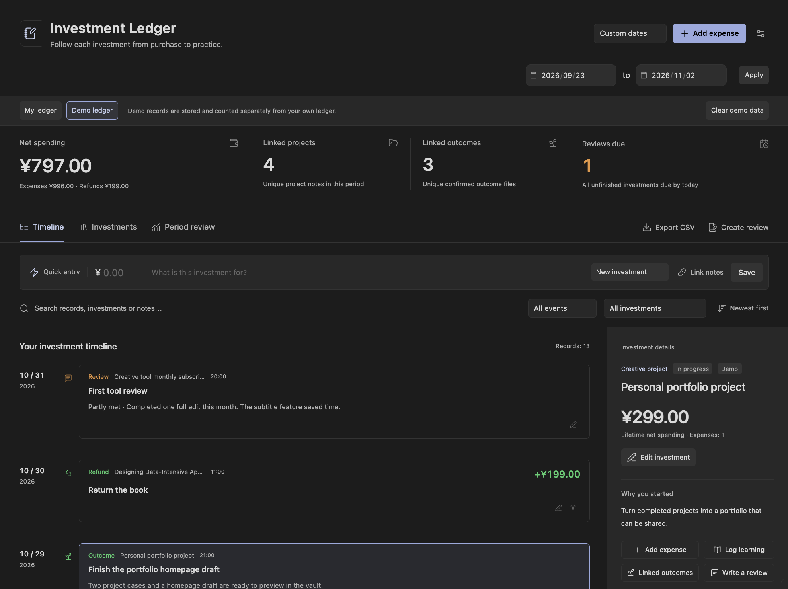

# Learning & Creative Investment Ledger

**English** · [简体中文](README.zh-CN.md)

An Obsidian plugin that connects spending on courses, books, tools and creative projects to learning notes, practice, outcomes and follow-up reviews. Follow an investment from its first purchase to what you actually made or learned.

Version **0.4.0 — early preview**. Requires **Obsidian 1.8.7+ on desktop**. Supports English and Simplified Chinese. Choose the original currency per expense; totals are grouped by currency without conversion. See the [release notes](RELEASE-NOTES.md) for preview scope and feedback instructions.

Maintained by [fineuralab](https://github.com/fineuralab). MIT licensed.

## Preview



## Language

The interface follows Obsidian by default: Chinese locales use Simplified Chinese; other locales use English. In the plugin settings, choose **Follow Obsidian**, **简体中文**, or **English**. The choice takes effect immediately and survives restarts.

Commands, forms, attachment controls, messages, summaries, CSV headers and generated Markdown use the selected language. Changing the language preserves your own titles, notes, reflections, existing demo content, amounts and file paths. A newly loaded demo uses the current language; clear and reload it to try the other language.

## Install

Use `learning-investment-ledger-0.4.0.zip` from the [Releases page](https://github.com/fineuralab/obsidian-learning-investment-ledger/releases) when published, or build it using [Build from source](#build-from-source). GitHub's **Code → Download ZIP** contains source files and requires a build before installation.

1. Unzip the archive.
2. Copy its `learning-investment-ledger` folder into `<your-vault>/.obsidian/plugins/`.
3. Ensure `main.js`, `manifest.json` and `styles.css` are directly inside that folder, without an extra nested folder.
4. Reload Obsidian, allow community plugins if Restricted Mode is enabled, and enable **Investment Ledger · 学习与创作投入账本** in **Settings → Community plugins**.
5. Click the ledger icon in the left ribbon or run the plugin's **Open ledger** command.

```text
Your vault/
  .obsidian/
    plugins/
      learning-investment-ledger/
        main.js
        manifest.json
        styles.css
```

For updates, replace those three files and reload the plugin. Ledger data is stored separately as vault Markdown and remains readable after uninstalling. This repository does not bundle a real user's ledger.

## Record your first investment

Click **Record your first investment** in the empty state or **Add expense** at the top. Choose an existing investment or create one; provide a name, category, purpose, amount and date. For example, create a Practical Python course with a CNY 399 purchase. The first expense suggests a review 30 days later; change or clear that date if needed.

For a quick entry, enter an amount and purpose, then choose an investment or create a new one. New investments initially use the purpose as their name and the Other category. Add the reason, category, project, notes and status later through **Edit investment**. Quick entries use today's local date and time.

## Practice, outcomes and reviews

Select a timeline event or investment card to open its details. On narrow windows the details appear in a dismissible panel; close it with the button, backdrop or Escape.

- **Add expense:** keep recurring subscriptions and other purchases under the same investment.
- **Log learning:** describe what you did, link notes and optionally enter a positive whole number of minutes.
- **Linked outcomes:** explicitly select a finished note or vault file and describe the result. Opening a note or spending time in it is never treated as proof of learning or an outcome.
- **Write a review:** compare the original expectation with actual use, outcomes and next steps. Set another review date or leave it blank to finish the schedule. Reviews are retained and can be edited.

An unfinished investment is due when its review date is today or earlier. Click **Reviews due** to see the list. On hold remains unfinished; clear its review date to stop reminders. Reminders stay inside the plugin.

## Refunds, edits and deletion

Use an expense's refund button to select the original payment and record a full or partial refund. Cumulative refunds cannot exceed the original expense, and a refund cannot occur before it.

Events can be edited or deleted with confirmation; remove linked refunds before deleting their original expense. Unlinking an outcome keeps its file. Deleting an entire investment moves its Markdown and event history to the vault trash, while linked notes and outcome files remain.

Successful changes update the timeline and totals immediately. A failed save shows the error and keeps the form input for retry.

## Attach files, images and web links

Every investment and every event type—expense, refund, learning, outcome and review—has an attachment section.

- **Link vault file:** search existing notes, PDFs, images, scripts or other vault files.
- **Add from computer:** choose multiple files, drop them into the attachment area, or focus the paste area and paste a screenshot.
- **Add web link:** add an HTTP or HTTPS URL with an optional name. External links open only when clicked; remote images are never fetched or embedded automatically.

PNG, JPG, JPEG, GIF, WebP, AVIF and BMP images have thumbnails and a larger preview. Other attachments open as file links. Timeline cards preview up to four attachments; select the event to see all of them.

Computer files are copied into the ledger's `附件/` folder on save, or `演示数据/附件/` in demo mode. Originals are kept. Cancelling before the first save imports nothing. If copying succeeds but the record save fails, retry reuses the imported file. Imported files remain after cancelling, unlinking, deleting records or clearing demo data; organize them in your vault when appropriate.

Imports are limited to 50 MB per file. For larger files, place them in the vault and link them. File moves and renames update attachment paths; deleted targets remain visible as missing links.

Attachments do not count as confirmed outcomes. They appear in source Markdown, review notes and the CSV attachment column. Existing 0.1 and 0.2 records remain compatible without migration.

## Per-transaction currencies

Choose a currency in **Quick entry** or the expense form. Supported codes: CNY, USD, EUR, GBP, JPY, HKD, TWD, KRW, SGD, AUD, CAD, NZD, CHF, INR, MYR, THB, KWD and BHD. A single investment can contain payments in different currencies. Changing the selection does not convert the entered number.

Period totals, category charts, investment details and Markdown reviews show each currency separately. There is no combined monetary total or automatic exchange rate. Large totals retain every minor unit, including above JavaScript's safe integer range. Linked projects, outcomes and reviews due retain their existing counting rules. CSV exports include a **Currency** column and original-currency numeric amounts.

Refunds always use the original expense's currency. An expense with linked refunds cannot change currency. Full and partial refund limits are checked in the original minor units.

Existing records without a `currency` field remain CNY with unchanged amounts and IDs; simply opening or switching language does not rewrite files. Files that first receive a foreign-currency transaction upgrade to `schema: 2` and require plugin 0.4.0 or later. Keep a vault backup before updating; older plugin versions will report these new files as unsupported rather than treating foreign amounts as CNY. Existing CNY-only files remain `schema: 1`.

The preview screenshots show the earlier CNY demo; version 0.4.0 adds the per-transaction currency selectors and separate currency totals.

## Dates, filters and accounting

Choose **This month**, **Last 30 days**, or **Custom dates**, including both start and end dates. Last 30 days means today plus the previous 29 days. The timeline defaults to oldest first and orders same-day events by time; reverse the order when needed.

This month and Last 30 days follow the current local date. The view checks for a new day every minute and when its window regains focus or visibility. Custom dates stay fixed.

Combine event type, investment and keyword filters. Search includes investment names, reasons, note paths, event content and translated category labels. The Investments page covers all dates.

| Metric | Definition |
| --- | --- |
| Net spending | Expenses minus refunds in the period, calculated independently for each currency; can be negative |
| Linked projects | Unique project-note paths attached to investments with events in the period |
| Linked outcomes | Unique vault-file paths explicitly confirmed by outcome events in the period |
| Reviews due | All unfinished investments due by today, regardless of the selected period |

Top totals, CSV and review exports always cover the **full selected period**. Additional list filters do not change that scope. Demo and personal ledgers are counted and exported separately.

Amounts use integer minor units with currency-specific precision: JPY and KRW have no decimal places, CNY and USD have two, and KWD and BHD have three. No rounding or exchange-rate conversion is applied. Account balances, income, transfers and asset management are outside this plugin's scope.

## Linked notes and recovery

Notes and outcomes open through Obsidian. Native file or folder moves update structured paths. A deleted target keeps its link and displays an actionable missing-link message: edit the record, remove the old link and choose a replacement.

The **Period review** page groups spending by category and lists the related investments, practice, outcome and note links.

- **Export CSV:** save expenses and refunds for the period with UTF-8 BOM, stable IDs, dates, times, categories, purpose, amounts, net impacts, original expense IDs, notes, attachments and demo flags. Each row includes its currency code and amounts in that original currency, using its own precision.
- **Create review:** write your reflection, then save a Markdown note with spending, investments, learning, deduplicated outcomes, reviews due and review history.

Exports go into the ledger's `复盘/` subfolder. Names receive a suffix rather than overwriting existing files. CSV text fields are quoted and protected against spreadsheet formula injection; numeric amounts remain numeric.

## Storage and privacy

Choose a relative vault data folder in the plugin settings. New installations default to `Investment Ledger` in English or `投入账本` in Chinese. Existing default Chinese folders are detected on update. Switching languages does not rename or migrate any folder.

```text
Investment Ledger/
  投入-<stable-id>.md       # One investment and all its events
  附件/                    # Imported files and images
  演示数据/                # Created only when you load the demo
    投入-demo-python.md
    笔记/...
  复盘/
    Transactions-start-end.csv
    Investment-review-start-end.md
```

Internal subfolder names and schema enum values stay stable across languages for compatibility. Human-readable generated sections and exports use the selected language. See [Data format](docs/data-format.md) / [数据格式](docs/data-format.zh-CN.md).

YAML frontmatter is the source of structured records. The body provides a readable timeline. Everything below `<!-- ledger:appendix -->` belongs to you and is preserved on save. The in-memory index can be rebuilt from source files.

Changing the configured folder reads the new location and keeps the old files. To migrate, move the entire folder in Obsidian first and update the setting. Back up the data folder using your preferred vault backup or sync method; resolve multi-device conflicts before editing the same file.

Parsing errors, duplicate IDs and unsupported versions identify the affected file. During a session, the last good record remains visible and writes to the damaged source are blocked. On a fresh start an unreadable file cannot be counted until repaired. Fix it and rebuild the index. External edits and stale forms are checked before overwriting; copy unsaved input before closing and reopening a stale form.

The plugin makes no network requests, collects no telemetry and never infers outcomes from browsing behavior. Files you choose to add remain subject to your own vault sync settings. Web attachments open in the browser only on an explicit click.

## Demo data

Load the optional demo from the empty state or plugin settings. It includes a CNY 399 course, CNY 199 book, CNY 99 tool, CNY 299 creative project and CNY 199 refund, plus learning, outcomes and a review. The initial demo period includes all events, with net spending of **CNY 797**.

Personal and demo records use separate tabs and totals. Clearing the demo moves only demo investments and marked example notes to trash. Unmarked files and attachment assets are retained. Loading again is idempotent.

The [demo directory](demo/README.md) contains separate Chinese and English source examples, dated 2026-11-02. Use the in-plugin loader for correctly linked paths and dates relative to today; do not combine both static demo copies into one ledger, because their stable demo IDs intentionally match.

## Build from source

Requires Node.js 22+, npm, and Python 3 (`python3`) for ZIP packaging.

```sh
npm ci
npm test
npm run build
npm run package
```

`build` runs strict TypeScript checks and generates `main.js`. `package` produces installation and source ZIPs under `dist/`. `npm run dev` watches source changes; copy the three runtime files to an isolated test vault and reload the plugin. `npm run demo` regenerates both static demo languages.

Generated `main.js`, dependencies, `dist/`, test output, editor settings and real ledger data are ignored by Git. Source packaging uses an explicit public-file allowlist. Runtime ZIPs include the compiled plugin, both READMEs, documentation and license notices.

The package command also prepares a versioned upload folder, bilingual release notes, SHA-256 checksums and a materials ZIP. Downloadable archives exclude hidden files and normalize ZIP dates and host attributes. See [release preparation](PUBLISHING.md).

The 76 automated tests cover accounting, refunds, persistence, stale forms and delete confirmations, YAML recognition, rolling dates, review scheduling, links, attachments, exports, demo isolation and bilingual compatibility. Nine release-boundary checks cover metadata, private values, hidden files, symlinks, nested archives, checksums and matching runtime assets. See [Verification](docs/verification.md) / [验收记录](docs/verification.zh-CN.md) for validation scope and historical native-app checks.

## Scope and license

Implemented: investments, expenses/refunds, vertical timeline, note links, learning logs, explicitly linked outcomes, reviews, local Markdown persistence, search/filtering, summaries, Markdown reviews, CSV export, attachments and isolated bilingual demos. The UI uses Obsidian theme variables for light and dark themes.

Bill import, OCR, automatic exchange-rate conversion, automatic time tracking, dedicated mobile layouts and external service integrations are deferred. Per-transaction currencies and separate currency totals are included in 0.4.0.

MIT license. The bundled YAML parser uses ISC; see [third-party notices](THIRD-PARTY-NOTICES.txt).
