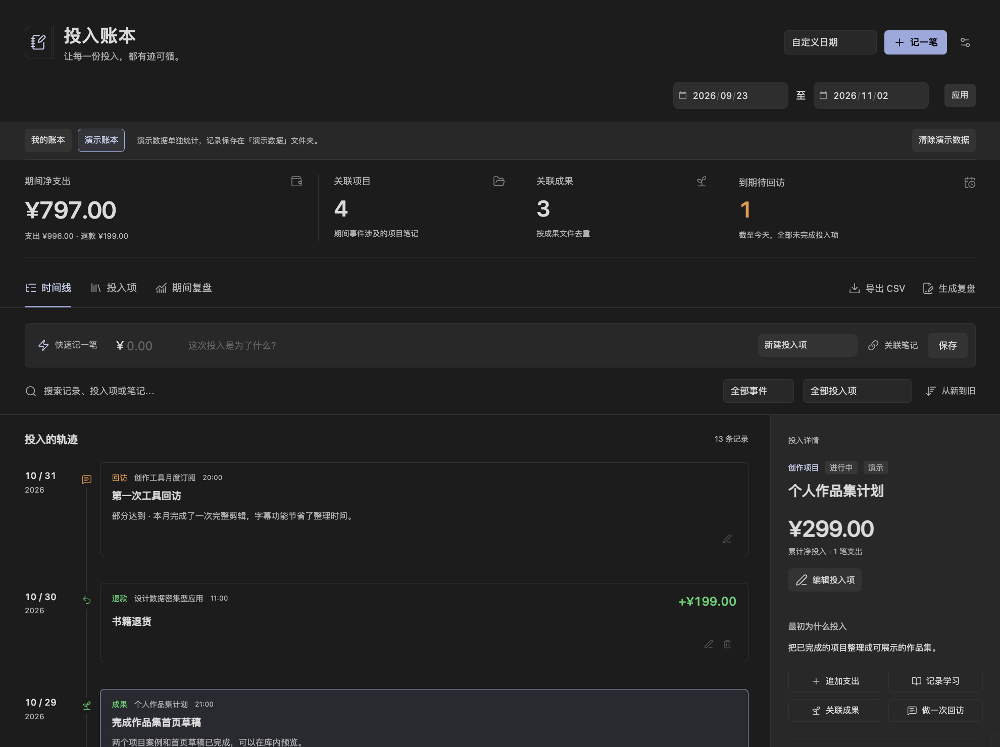

# 学习与创作投入账本

[English](README.md) · **简体中文**

运行在 Obsidian 内的个人投入账本。将课程、书籍、工具和创作项目的花费，连接到学习记录、项目笔记、实际成果与回访评价。

版本：0.3.0（早期预览版，支持中文 / English、附件与图片）。支持 Obsidian **1.8.7 及以上桌面版**，人民币单币种。预览范围和反馈方式见[发布说明](RELEASE-NOTES.zh-CN.md)。

维护者：[fineuralab](https://github.com/fineuralab)。许可证：MIT。

## 界面预览



## 语言

界面默认跟随 Obsidian：中文环境显示简体中文，其他语言环境显示英文。可在插件设置的「界面语言」中选择「跟随 Obsidian」「简体中文」或「English」，保存后立即生效，重启后保留。命令、表单、附件提示、错误信息、汇总与导出采用所选语言。切换语言不会翻译或改写你的名称、笔记、评价、已有演示内容、金额及文件路径。英文环境首次载入演示时生成英文内容；已有演示保持原内容，可清除后重新载入。

## 安装

1. 发布后从 [Releases 页面](https://github.com/fineuralab/obsidian-learning-investment-ledger/releases)下载并解压 `learning-investment-ledger-0.3.0.zip`，也可按文末说明自行构建。GitHub 的「Code → Download ZIP」是源码，需要构建后安装。
2. 将其中的 `learning-investment-ledger` 文件夹复制到你的库：`<库目录>/.obsidian/plugins/`。
3. 确认插件目录内直接包含 `main.js`、`manifest.json`、`styles.css`，不要多嵌套一层文件夹。
4. 重新加载 Obsidian，在「设置 → 第三方插件」启用「Investment Ledger · 学习与创作投入账本」。如果库处于受限模式，需先允许第三方插件。
5. 点击左侧工具栏的账本图标，或在命令面板执行「Investment Ledger · 学习与创作投入账本：打开投入账本」。

安装目录示例：

```text
你的笔记库/
  .obsidian/
    plugins/
      learning-investment-ledger/
        main.js
        manifest.json
        styles.css
```

更新时替换这三个文件，再禁用、启用插件或重启 Obsidian。真实数据保存在库内的数据文件夹，卸载插件仍可直接阅读。

## 记录第一笔投入

在空账本点击「记录第一笔投入」，或在顶部点击「记一笔」。填写名称、类型、用途、金额、日期；可以选择已有投入项，也可以当场创建。例如：

- 投入项：Python 实战课程；类型：课程。
- 用途：购买 Python 实战课程；金额：399 元。
- 首次支出默认建议 30 天后回访；可以修改或清空建议日期。

赶时间时，使用快速记录栏填写金额、用途，选择已有投入项或新建投入项。新建时以用途作为名称，类型暂存为「其他」，随后在右侧「编辑投入项」补充类型、购买原因、项目、笔记和状态。快速保存使用今天和当前本地时间。

## 学习、成果与回访

点击时间线事件或投入项卡片，右侧显示该投入的完整详情。窄窗口点击后打开详情面板，可通过关闭按钮、遮罩或 Escape 关闭。

- **追加支出**：软件的每月订阅等费用可以持续记到同一投入项。
- **记录学习**：记录本次做了什么，可关联笔记、填写正整数分钟时长。
- **关联成果**：主动选择库内笔记或文件，填写成果名称和说明。插件不会用打开次数、停留时长判断学习成果。
- **做一次回访**：记录最初期待、实际使用、留下的成果、是否达到预期和下一步。填写下一次回访日期，或留空结束本次回访安排。所有回访事件保留，可编辑，不提供删除。

回访日期不晚于今天、且投入状态不是「已完成」时，顶部计入「到期待回访」。点击数量查看这些投入项。「已搁置」仍属于未完成，若无需继续提示，可清空其回访日期。提醒只在插件内显示。

## 退款、编辑与删除

每条支出事件右下角有退款按钮。选择原支出并填入退款金额，支持分次部分退款；累计不得超过原支出。退款发生日期和时间不得早于原支出。

事件右下角可编辑或删除。删除需要确认，有关联退款的支出须先删除对应退款。解除成果关联会保留成果文件。删除整个投入项会将该投入的 Markdown 文件及其全部事件移到库内 `.trash`，关联笔记和成果文件会保留。

编辑或删除成功后，时间线、净支出和期间汇总立即更新。保存失败时，输入保留，界面显示具体文件与错误，修复后可以重试。

## 给记录附加文件、图片或网址

支出、退款、学习、成果、回访的新增与编辑表单，都有统一的「附件」区域；投入项本身也可以添加附件。

- **关联库内文件**：搜索并选择已有 PDF、图片、脚本、压缩包或其他库内文件，可关联多个。
- **从电脑添加**：选择一个或多个本地文件。也可把文件拖到附件区域，或聚焦「拖入文件或粘贴图片」区域后粘贴截图。
- **添加网址**：粘贴 `https://` 或 `http://` 地址，可填写链接名称。网址仅在点击时交给浏览器打开，不会自动下载或嵌入远程图片。

PNG、JPG、JPEG、GIF、WebP、AVIF、BMP 图片显示缩略图，点击放大；其他类型显示可打开的文件链接。时间线每条记录最多预览四项附件，选中事件后可在右侧查看全部，编辑表单可移除关联。

电脑文件在保存记录时复制到数据文件夹的 `附件/`，演示模式下放在 `演示数据/附件/`；原文件不移动。首次保存前取消，不会导入文件。若附件已复制、但记录保存失败，文件与表单选择会保留，重试会复用已复制文件，避免重复导入。已保存的文件不会随取消表单、移除关联、删除记录或清除演示记录而自动删除，可在库内自行整理。

单个电脑导入文件上限 50 MB；更大的文件可先放入库内，再使用「关联库内文件」。文件移动或重命名后更新附件路径；删除后保留附件记录并提示链接失效。

附件不是已确认成果，不会自动增加成果统计。Markdown 源文件与复盘笔记保留附件链接，库内图片以 `![[图片路径]]` 嵌入；CSV 新增「附件链接」列。0.1.0 旧记录可以直接读取，无需迁移。

## 时间范围、筛选与统计口径

顶部支持「本月」「近 30 天」「自定义日期」，含开始、结束两个自然日。近 30 天指今天及之前 29 天。时间线默认从旧到新，同日按填写时间排序，支持切换顺序。

「本月」「近 30 天」随本地日期更新；视图每分钟及窗口恢复聚焦、可见时检查日期变化。自定义日期保持固定。

时间线支持事件类型、投入项和关键词组合筛选。关键词可匹配投入名称、购买原因、笔记路径及事件内容。「投入项」页显示所有投入项，不受日期范围限制。

| 数值 | 计算方式 |
| --- | --- |
| 期间净支出 | 期间发生的支出减去期间发生的退款，退款按自己的发生日期计入；可能为负数 |
| 关联项目 | 当前期间相关事件所属投入项的项目笔记，按路径去重 |
| 关联成果 | 当前期间成果事件中的成果文件，按库内路径去重；同一成果关联多个投入项只算一项 |
| 到期待回访 | 截至今天，未完成且回访日期不晚于今天的全部投入项，不受日期范围限制 |

顶部统计、CSV 与复盘笔记始终采用**整个所选期间**。时间线筛选和期间复盘页的投入项、关键词筛选仅缩小列表，不改变顶部统计或导出范围。演示账本与真实账本分别统计和导出。

金额以整数「分」保存，界面显示两位小数；单笔金额上限为 9,999,999,999.99 元。不包含账户余额、收入、转账和资产管理。

## 关联笔记和成果

「关联笔记」「选择文件」会搜索库内现有内容，笔记链接通过 Obsidian 原生方式打开。文件或文件夹重命名、移动后，插件会更新结构化路径并保存。

目标被删除时，原路径和记录保留，并标注「链接失效」。在投入项或事件编辑表单中移除旧关联、重新选择文件即可。点击失效链接也会显示操作提示。

## 月度复盘与导出

「期间复盘」按课程、书籍、工具、创作项目等类型展示支出与净支出，列出相关投入项、学习记录数量和成果、笔记链接。

- **导出 CSV**：将所选期间的支出与退款保存到数据文件夹的 `复盘/` 中，使用 UTF-8 BOM，包含稳定 ID、日期、时间、分类、用途、金额、净影响、原支出 ID、笔记路径和演示标记。金额列以元显示。
- **生成复盘**：先填写自己的评价，再生成 Markdown 笔记，包含期间净支出、主要投入、学习记录、去重成果、待回访、回访历史和用户评价。保存后用 Obsidian 打开。

导出文件自动增加后缀，不覆盖已有复盘。CSV 文本列会转义引号，并对可能被表格软件当作公式的文本加单引号；数值列保留原金额。

## 数据保存与恢复

在「设置 → 学习与创作投入账本」选择库内数据文件夹，新安装默认按界面语言使用 `投入账本` 或 `Investment Ledger`；已存在的默认中文数据文件夹继续读取。切换语言不会改名或迁移文件夹。

```text
投入账本/
  投入-<稳定ID>.md           # 一篇文件包含一个投入项和它的全部事件
  附件/                     # 从电脑导入的文件和图片
  演示数据/                 # 只有主动载入后才创建
    投入-demo-python.md
    投入-demo-book.md
    投入-demo-tool.md
    笔记/...
  复盘/
    投入流水-起日-止日.csv
    投入复盘-起日-止日.md
```

YAML 属性是结构化记录的源数据，正文提供易读时间线；`<!-- ledger:appendix -->` 以下为用户补充区，插件保存时保留。插件可以从源文件完整重建内存索引，不依赖数据库或隐藏缓存。

修改文件夹设置不会自动搬迁旧文件。如需迁移，在 Obsidian 文件管理器中移动整个数据文件夹，再修改插件设置到新位置。可用 Obsidian 同步或自己习惯的方式备份该文件夹；多设备同时编辑同一文件时，需先解决同步冲突。

文件无法解析、ID 重复或版本不支持时，界面列出具体文件。当前会话保留该文件上一次成功读取的记录，并禁止覆盖有问题的文件；首次启动没有可恢复的缓存时，该文件不会计入统计，问题提示仍保留。修复源文件后点击「重建索引」。外部文件发生修改时，插件通过内容比对阻止旧表单覆盖新版本；请先复制尚未保存的内容，再关闭、重开表单。

完整数据格式见 [数据格式（中文）](docs/data-format.zh-CN.md)。

## 演示数据

首次空状态可点击「载入演示数据」，有真实记录后可从插件设置中载入。演示含 399 元课程、199 元书籍、99 元工具、299 元创作项目、199 元退款，以及学习、成果和回访。载入后自动选择覆盖所有演示事件的时间范围，净支出为 **797 元**。

演示账本与真实账本通过标签切换。点击「清除演示数据」并确认后，只将演示投入项和带演示标记的示例笔记移到回收站；自行放入演示目录、且未带演示标记的普通笔记会保留。重复载入不会重复创建同一演示项。

交付中的 `demo/` 是独立示例文件，便于查看源格式。日常体验建议使用插件内载入功能，以便按今天生成日期、正确关联当前数据文件夹。无需手动复制演示文件。

## 从源码构建

需要 Node.js 22 或以上和 npm；生成 ZIP 安装包另需 Python 3（命令 `python3`）：

```sh
npm ci
npm test
npm run build
npm run package
```

`build` 先运行严格 TypeScript 检查，再生成可直接运行的 `main.js`。`package` 输出安装 ZIP 和源码 ZIP 到 `dist/`。开发时运行 `npm run dev`，将输出的三件套复制到测试库后重新启用插件。

打包命令还会生成版本上传目录、中英文发布说明、SHA-256 清单及材料 ZIP；下载归档排除隐藏文件，并统一 ZIP 时间与机器属性。步骤见[发布准备](PUBLISHING.md)。53 项自动化测试覆盖插件功能、旧表单与删除确认、YAML 识别、动态日期及回访安排，另有 9 项发布边界检查覆盖元数据、隐私标记、隐藏文件、符号链接、嵌套归档、校验值及运行文件一致性。

源码仓库不提交自动生成的 `main.js`、`node_modules/`、`dist/`、测试输出、编辑器配置或真实账本数据；这些内容已加入项目的 `.gitignore`。`styles.css`、`manifest.json`、源码、测试、说明及独立演示数据保留。安装包用于 GitHub Releases；源码 ZIP 按文件白名单生成，不包含本地依赖、配置、构建产物或未知的根目录文件。清理后的源码首次构建请先运行 `npm ci`。

核心测试覆盖金额、退款上限、跨期统计、时间线、成果去重、回访、持久化、失败重试、源冲突、重复 ID、链接移动、CSV 和演示清理。真实 Obsidian 的验收脚本与结果说明见 [验收说明（中文）](docs/verification.zh-CN.md)。

## 实现范围

已实现需求的 P0 与 P1：投入项、支出退款、时间线、笔记和成果关联、学习、回访、Markdown 持久化、筛选、期间统计、复盘、CSV 和独立演示。首版面向桌面，使用 Obsidian 原生主题变量。

账单导入、OCR、多币种、自动计时、移动端专门优化和外部服务连接未纳入本版。

许可证：MIT。捆绑的 YAML 解析器采用 ISC 许可证，见 `THIRD-PARTY-NOTICES.txt`。
